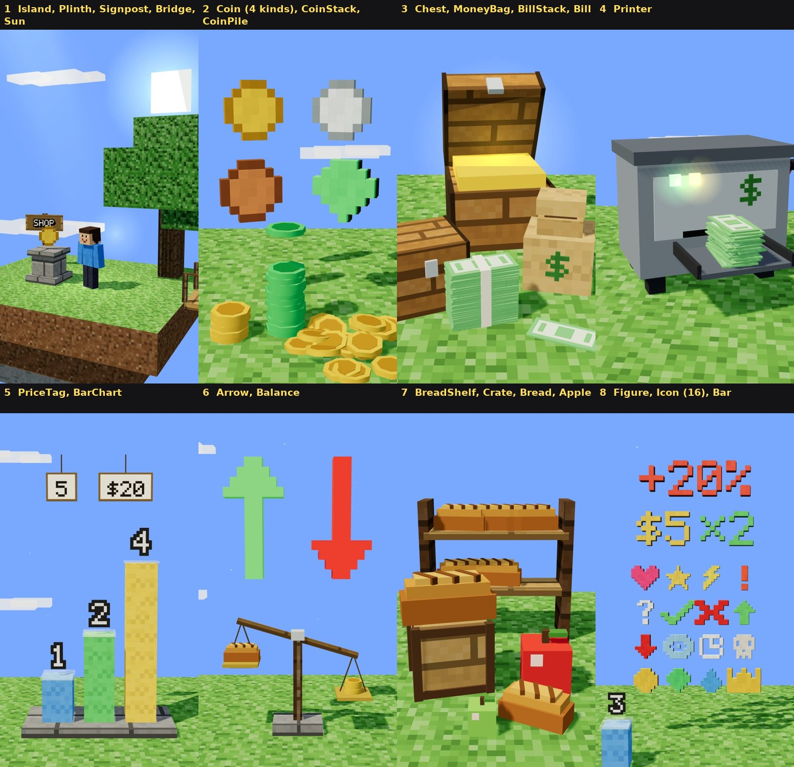

# The Explainer pack

Everything a film of this topic is built from. One import:

```ts
import { Island, Coin, BarChart, flightScene, stop } from "../../../Topics/Explainer";
```

A film's `kit.tsx` imports from the pack and passes the names on, so its scenes import only from `"./kit"`.



> **Not yet approved in a film.** Every other pack in this framework was taken out of films the owner approved.
> This one was built ahead of its first film, so each part here has been rendered and looked at (the picture
> above) but none has been seen by the owner in a film. The first approved explainer decides what stays.

1 unit = 1 block = 1 metre. `position` is the middle of a part's underside unless its row says otherwise.
Everything is deterministic: a part that moves is given seconds (`t`, or `clock.useSince(…)`), never a clock of its own.

## The camera — `flight.tsx`

[`SHOTS.md`](SHOTS.md) is the guide. Picture: none; it is the camera.

| Name | What it is |
|---|---|
| `stop(lookAt, metres, yaw°, pitch°, fov°)` | A framing the camera comes to rest on |
| `near(stop, { closer, turn, raise, on, fov })` | A second stop made from a first: for the second line about one thing |
| `flightScene(timing, { id, title, from, shots })` | A scene whose camera flies to one stop for each narration line |
| `unbroken(film.scenes, { maxCuts })` | Throws if the camera teleports. Called in `film.tsx` |
| `eyeOf(stop)` | Where the lens is when the camera is on a stop |

## The stage — `stage.tsx` (picture 1)

| Part | Props | Use it for |
|---|---|---|
| `Island` | `position` (the middle of its TOP), `size` [x, z], `layers`, `top`, `under`, `rock`, `seed` | One idea. People and things stand at `position[1]` |
| `Sun` | `position`, `size` | The square sun of a Minecraft sky. A picture of a sun, not the light |
| `Plinth` | `position`, `height`, `width` | One thing shown on its own. Its top is `height` over `position` |
| `Signpost` | `text`, `position`, `rotationY`, `height` | The NAME of a place, in the world. One or two short words |
| `Bridge` | `from`, `to` | Two ideas that are joined |

## Money — `money.tsx` (pictures 2–4)

Use ONE kind of money in a film, and keep it. A village trades in emeralds: `kind="emerald"`.

| Part | Props | Use it for |
|---|---|---|
| `Coin` | `position` (its middle), `size`, `kind` (`gold` `silver` `copper` `emerald`), `spin`, `glow` | One coin as the subject of a shot. `spin={t * 3}` turns it in the air |
| `CoinStack` | `position`, `count` (may be a fraction), `kind` | An amount. `count={12 * k}` grows it as a number is said: the top coin drops in |
| `CoinPile` | `position`, `count`, `spread`, `kind`, `seed` | "A lot". A heap is `spread={0.4}`; a mess is `1.6` |
| `Bill` | `position`, `rotationY`, `color` | One banknote, lying flat |
| `BillStack` | `position`, `count`, `rotationY` | A banded stack of notes |
| `MoneyBag` | `position`, `full` 0–1, `sign` | Money that belongs to somebody |
| `Chest` | `position`, `open` 0–1, `gold` 0–1 | A saving: something kept. Open it on the word |
| `Printer` | `position`, `out` (notes so far; may be a fraction), `tray`, `running`, `sign` | More money being made. `out={t * 3}` prints three a second. `sign` is the letter on its side: `$` unless you say so (`sign="M"` for marks) |

## Numbers you can stand next to — `charts.tsx` (pictures 5–6, 8)

| Part | Props | Use it for |
|---|---|---|
| `PriceTag` | `text`, `position` (the knot at the top of its string), `scale`, `swing` | The price OF something. Hang it on the thing. Change `text` on the word and the price has changed |
| `Bar` | `position`, `height`, `width`, `color`, `label` | One column. Its label rises with it |
| `BarChart` | `position`, `values` (metres), `grow` (0–1, one number or one for each bar), `labels` | "It doubled." `grow={[1, 1, k]}` holds two bars and raises the third |
| `Arrow` | `position` (its tail), `dir` (`up` `down` `right` `left`), `length`, `grow` 0–1 | More, or less. Green goes up and red goes down |
| `Balance` | `position`, `tilt` −1…1, `left`, `right` (anything, on each pan), `scale` | What a thing is WORTH against what it COSTS |

## Things money buys — `goods.tsx` (picture 7)

| Part | Props | Use it for |
|---|---|---|
| `Bread` | `position`, `rotationY`, `scale` | The thing everybody knows the price of. `scale={2}` for a shot about it |
| `Apple` | `position`, `scale`, `color` | A second thing, when the film needs to say "and everything else" |
| `Crate` | `position`, `size`, `label` | Stock, a delivery, "more of them" |
| `BreadShelf` | `position`, `count`, `width` | A shop that has plenty, or one that has not |

## Shared with the other topics — [`Topics/Shared`](../Shared/README.md) (picture 8)

| Part | Use it for |
|---|---|
| `Figure` (`text`, `height`, `color`, `glow`, `outline`) | A number or a short word in cubes: "+20%", "$5", "×2". Six signs or fewer |
| `Icon` (`kind`, `height`, `color`) | One small picture in cubes. Sixteen kinds: heart star bolt bang question check cross up down eye clock skull coin gem drop crown |
| `Voxels` (`rows`) | Any picture you draw yourself, in rows of `#` |
| `filmClock(timing)` → `clock.useSince(cue, word)`, `clock.at`, `clock.end` | When a word is said, in seconds of the whole film |
| `pop`, `ramp`, `ease`, `jolt`, `ahead`, `beside`, `faceOf`, `chestOf`, directions | Staging, from In This Town |
| `Player`, `Villager`, `ROBE`, `Hut`, `Stall`, `LampPost` | People and a village, from In This Town ([its pack](../InThisTown/PACK.md)) |
| `Bubble`, `Bits`, `Puffs` | A speech bubble; bits that fly when something breaks; puffs of dust |
| `SubscribeSign` | The red sign every film of the channel ends on |

## Parts waiting in the first film

The pack was made before its first film, and that film found out what it lacked. These are in
[`src/videos/why-does-bread-cost-more-every-year/parts.tsx`](../../src/videos/why-does-bread-cost-more-every-year/parts.tsx),
built to the rules below (a `position`, seconds, no knowledge of that film's islands). Import them from there until
the owner has approved the film; then they move into this folder unchanged, and get a row above and a place on the sheet.

| Part | What it is FOR |
|---|---|
| `Oven` | A baker's oven: `fire` 0–1 flares on a word, and its flat top holds a stack of what it made |
| `Loaf` | The pack's `Bread` in two halves. `split` (metres) pulls them apart: "each coin buys less" |
| `PriceRoll` | A price too long for a tag. `rows` unroll one at a time (`shown`): 200 / ,000 / ,000 / ,000 |
| `Balloon` | Tie a price to its knot and grow `size` on the word: the thing called inflation |
| `FigureBubble` | A speech bubble that says a NUMBER. `Bubble` writes in the caption font, whose black edge turns a dark "10" into two blobs |
| `Wheelbarrow`, `NoteHeap` | What a man brings to pay for one loaf, and the heaps nobody picks up |
| `NoteFall` | Notes pouring off the edge of an island for as long as the film runs |
| `NoteBundle` | One banded bundle, for a stack that is counted by its height |

## Adding a part

1. Build it in the film first, in its `kit.tsx`. A part goes into the pack when a second film could use it.
2. Put it in the file it belongs to, with a comment that says what `position` is and what it is FOR.
3. It takes a `position`, so it does not know where a film's islands are. If it moves, it takes seconds.
4. Add its row to the table above, and add it to the sheet (below).
5. If you change a part that a finished film uses, prove the film did not change:
   `python3 scripts/compare-stills.py out/before/<film> out/after/<film>`.

## Rebuilding the sheet

`pack.jpg` is eight stills of a film that exists only to show the parts. Its source is in [`sheet/`](sheet/):
eight islands with one group of parts on each (`world.tsx`), a stop at each (`scene1.tsx`), and the name over
each picture (`labels.txt`). To add a part, stand it on an island there, or add an island, a stop, and a line of
`narration.md` and of `labels.txt`. Then:

```bash
npm run new -- "Pack Sheet" --topic explainer
cp Topics/Explainer/sheet/*.tsx Topics/Explainer/sheet/narration.md src/videos/pack-sheet/
#   delete the `captions:` line from src/videos/pack-sheet/film.tsx, so the stills have no words on them
python3 scripts/narration.py build pack-sheet --estimate
npm run shots -- pack-sheet --at 0.6 --out out/pack-explainer
python3 scripts/pack-sheet.py out/pack-explainer Topics/Explainer/pack.jpg --labels Topics/Explainer/sheet/labels.txt
#   then delete src/videos/pack-sheet/ and take its two lines out of src/registry.ts
```

`sheet/` is left out of the type check, like `template/`: its imports only resolve inside `src/videos/`.
