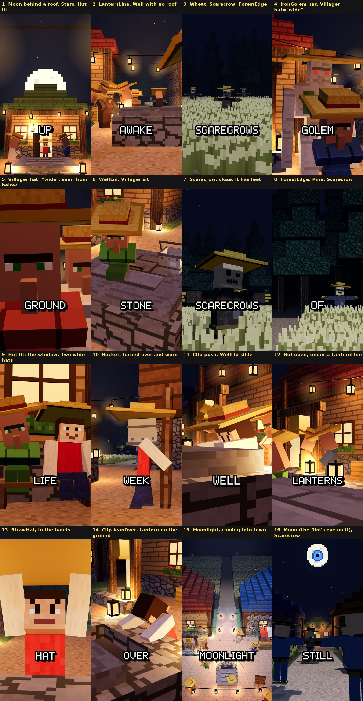
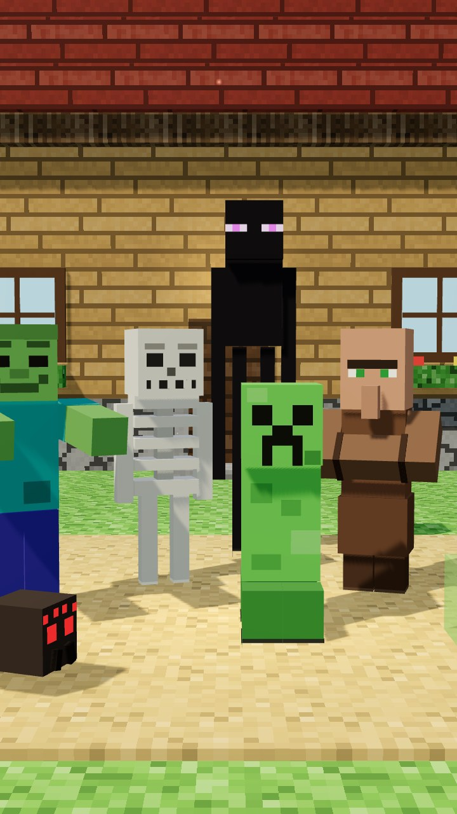

# The pack: what an "In This Town" film is built from

The people, places, things and staging maths of the finished films, kept in this folder so the next film starts from
them and not from nothing. The owner approved these as they look ("i like the assets"). **Use them. Do not rebuild
them, and do not restyle them.**


Every still above is a shot from one of two finished films: the reference film, `in-this-town-same-face` (the
first sixteen and the last), and `in-this-town-monster-egg`.



The second sheet is the night: the fields, the moon, the lanterns, and what is worn. Every still on it is a shot
from `in-this-town-nobody-looked-at-the-moon`. Those parts are listed under "Fields and night" below, and in the
rows for `things.tsx` and `places.tsx`. To make the sheet again:

```bash
node scripts/shots.mjs in-this-town-nobody-looked-at-the-moon --scale 0.5 --at 0.6 --out out/night \
  --only 1.wake,2.awake,2.crows,3.crows,3.forest,3.golem,3.eyes,3.lid,4.good,7.week,8.lid,10.town,10.hat,10.lean,11.light,13.held
python3 scripts/pack-sheet.py out/night Topics/InThisTown/pack-night.jpg --labels Topics/InThisTown/pack-night.labels.txt
```

## How a film uses it

```
Topics/InThisTown/index.ts      everything below, from one import
        ↓
src/videos/<film>/kit.tsx       passes on what the film uses, and adds the film's own: the teller, PLACE, timing
        ↓
src/videos/<film>/sceneN.tsx    imports only from "./kit"
src/videos/<film>/world.tsx     lays the town out with the pack's places
```

`npm run new -- "In This Town, …" --topic in-this-town` gives you a `kit.tsx` and a `world.tsx` that are already
wired this way. The reference for both is `src/videos/in-this-town-same-face/`.

**Before you build anything, look for it here.** If it is not here and a second film could use it, build it here
(the rules are at the bottom). Only what belongs to one story stays in that film's `kit.tsx`.

## Staging — `staging.ts`

| Name | What it gives you |
|---|---|
| `wordClock(timing)` | Makes `wordAt(cue, word, nth?)`: seconds into a shot at which a word is said. **Hang every action on a word** |
| `pop(t, at, dur?)` | The scale of a thing that pops into being at `at`: 0, a small overshoot, then 1 |
| `ramp(t, a, b)` | 0 before `a`, 1 after `b`, straight between. `ease(k)` smooths it |
| `jolt(t, at, size?)` | A short shake that dies away: a hit, a landing |
| `ahead(p, rotY, dist, up?)` | The point `dist` metres in front of someone |
| `beside(p, rotY, side, up?, front?)` | A point in someone's own axes: to their right, up, in front |
| `SOUTH` `EAST` `NORTH` `WEST` | Facings, as `rotationY`. The street runs west–east; the camera usually stands south |
| `DEG` | `Math.PI / 180` |
| `KID` | 0.8: the scale of a child player |
| `faceOf(p, scale?)`, `chestOf(p, scale?)` | Where a player's face and chest are, for the camera's `on` |
| `hill({ x, layers, width, step })` | The maths of a stepped hill: `stepAt(i)`, `stepEast(i)`, `climb(from, steps, p)`, `top` |

## The town's people — `villagers.tsx`

| Name | What it is | Props that matter |
|---|---|---|
| `Villager` | The villager. One face, one eyebrow, one long nose, arms folded into one block. **There is exactly one face: do not add another** | `robe`, `scale` (`ADULT` 0.94, `CHILD` 0.7), `kid`, `walk` (metres), `lookAt` (a world point), `nod` `turn` `tilt`, `hmm` 0–1, `strain` 0–1 (trying to get the arms out), `lean` (a bow), `hat` (`"straw"` a farmer's small hat, `"wide"` a `StrawHat` as wide as a door), `sit` (legs straight out, the way a doll sits: put `position` 0.56 m × scale under the seat), `phase` |
| `ROBE` | Eight robe colours: `brown elder friend white smith farmer red blue`. The robe is the only way to tell two villagers apart, so give each named one their own | |
| `villagerFace(p, scale?)`, `villagerChest(p, scale?)` | Where a villager's face and chest are, for the camera | |
| `IronGolem` | The iron golem, 2.7 m tall | `walk`, `armR` / `armL` (radians: 0 hangs, −1.5 points ahead; leave out and they swing), `headPitch`, `headYaw`, `bow`, `flower`, `hat` (a `StrawHat` 1.7 m wide) |
| `golemHand(p, rotY, angle, scale?, side?)` | Where its hand is in the world, for an arm at `angle`. Put the thing it gives there | |
| `Poppy` | A poppy. `position` is the bottom of the stem | `rotation`, `scale` |

## People who are not from the town — `players.tsx`

| Name | What it is | Props that matter |
|---|---|---|
| `Player` | One of twelve players, no two alike in skin, hair and clothes. Takes every `MinecraftAvatar` prop | `who` 0–11, `torch`, `light` (makes the torch a real light), `animation`, `face` |
| `PLAYERS` | The twelve looks. `who = 0` has a beard, `who = 2` wears a pumpkin | |
| `Pumpkin` | A carved pumpkin, worn as a head | `position` (its middle), `rotationY`, `scale` |

The **teller** is not in the pack. Each film has its own, in its `kit.tsx`: a kid in one loud colour nobody else in
that film wears.

## Things — `things.tsx`

| Name | What it is | Props that matter |
|---|---|---|
| `Bubble` | A speech bubble. It faces +Z: give it the camera's yaw | `text`, `position`, `rotationY`, `scale` (use `pop`), `dark`, `tilt`, `tail` −1 / 1 |
| `BedBox` | A Minecraft bed, red blanket. The pillow is at −Z | `position` (its middle, on the floor), `rotationY` |
| `Hole` | A hole in a floor: black, with a broken edge | `position`, `size`, `rim` |
| `Bits` | Bits of a block that has just been broken | `position`, `t` (seconds since the hit), `color`, `count`, `power`, `toward` |
| `Smoke` | A column of smoke that rises, swells and thins | `position`, `rise`, `spread`, `size`, `count`, `lean`, `opacity` |
| `SmokeBank` | A wall of smoke across a valley, seen from the west | `x`, `amount` (1 hides everything, 0 is clear), `part` (opens it like a curtain), `t` |
| `Wisps` | Smoke drifting across a face | `position`, `t`, `dir`, `reach`, `count`, `opacity` |
| `Blaze` | A roof on fire: cubes of flame that rise and redden | `position` (the bottom of it), `size`, `height`, `count` |
| `FireLight` | Warm, flickering light from a fire that is out of frame | `position`, `power`, `reach` |
| `StrawHat` | A straw hat with a flat square brim. `position` is where it sits: the middle of the top of a head. Put it inside the head's own group and it nods with the head | `width` (brim edge to edge; 1.1 is as wide as a door), `crown`, `tilt` (negative tips it back), `band`, `scale` |
| `Bucket` | An iron bucket. `position` is the middle of its rim; the body hangs under it. Turned over (`rotation={[Math.PI, 0, 0]}`) it fits over a head | `rotation`, `scale`, `handle`, `swing` (radians the handle has swung), `color` |
| `Lantern` | A lantern on a chain. `position` is the point it hangs from. The flame is always bright | `chain`, `light` (over 0 makes it a real light: use that on a few, not on all), `reach`, `sway`, `seed`, `scale` |

**Wearing a hat.** A villager and the iron golem wear theirs through a prop (`hat="wide"`, `hat`). A player wears
one through `MinecraftAvatar`'s `head` prop, whose origin is the **middle** of the head cube, so the hat sits 0.225 m
over it: `head={<StrawHat position={[0, 0.225, 0]} />}`. A hat on the ground or in a hand is just a `StrawHat` with
a `position`.

## Places — `places.tsx`

These are **parts**. Where they stand is the film's business: each film lays out its own town in its `world.tsx`.

| Name | What it is | Props that matter |
|---|---|---|
| `Hut` | A village house. `at` is the middle of its front wall, on the ground. `turn` 0 faces south | `w` `d` `h`, `wall` (a block kind), `tint`, `roof`, `door` (x offset), `windows` (x offsets), `burnt` (black, half a roof, long ago), `ablaze` (the windows glow; add `Blaze` and `Smoke`), `lit` (somebody is home and it is dark out: warm windows), `open` (the door stands open, with the light of the room in the doorway and on the step) |
| `Bell` | The village bell on its stone step | `position`, `fallen` |
| `Well` | The village well. The wall is 0.8 m high and 2.4 m square; the hole is 1.4 m square | `position`, `roof` (`false` leaves off the posts and the roof: an open ring to look down into, or to put a `WellLid` on) |
| `WellLid` | A stone lid for a well with no roof: a slab 2.1 m square, with an iron ring. `position` is the well's. Its top is y = 0.98 | `slide` (metres it has been pushed off, towards +Z; at 1.0 the gap behind it is 0.65 m), `turn` (which way it slides), `skew` |
| `Stall` | A market stall. Its counter top is y = 1.0 | `position` |
| `LampPost` | A torch on a post | `position`, `seed` |
| `LanternPost` | A `Lantern` on a post with an arm | `position`, `turn` (the way the arm points; 0 is south), `height`, `light`, `seed` |
| `LanternLine` | A line of lanterns strung between two points, sagging in the middle: across a street, from eave to eave | `from`, `to`, `count`, `sag`, `lit` (which of them are real lights, 0 = the first; the rest only glow), `light` |
| `Fence` | A post-and-rail fence from one point to another | `from`, `to`, `height`, `gap` (metres between posts) |
| `SteppedHill` | The slabs of a stepped hill. Give it the same numbers as `hill()` | `x`, `layers`, `width`, `length`, `step`, `taper`, `tints` |
| `Room` | A bedroom, 5.4 m wide and 8 m deep, one window. **No south wall: the camera lives there.** It has no bed; the scene puts one in | `at`, `night` |
| `Tunnel` | A tunnel through dirt, 16 m long, one block wide, two torches. Open at +x: the camera stands where the dirt still is | `at` |

## Fields and night — `fields.tsx`

What lies round the town, and what hangs over it after dark. Built for `in-this-town-nobody-looked-at-the-moon`,
which is the film to read for how they are used (`world.tsx`, and `skyAt()` in its `kit.tsx`). Any film may use them.

| Name | What it is | Props that matter |
|---|---|---|
| `Wheat` | A field of standing wheat on tilled soil, in rows that run west–east. `position` is the middle of the field, on the ground. The rows are cutout planes, so you see between them | `size` ([west–east, north–south] in metres), `height`, `rows` (metres between rows), `glow` 0–1 (how much it shines by itself: 1 under a moon, 0 in the dark), `sway`, `seed` |
| `Scarecrow` | A scarecrow, 2.3 m tall: taller than anyone in the town. A sack for a head, a stuffed shirt on a crossbar, a straw hat. **Standing, it does not move at all: no breath, no sway. That is the point of it** | `walk` (metres: it strides, stiff, arms still straight out), `pole` (a pole down its back into the ground, as if somebody had put it there), `lean`, `headTurn` `headTilt` `headNod`, `droop` (how far the arms have dropped), `eyes` 0–1 (a cold glint in the eye holes, and a cold edge on the body: **use it whenever one stands in the dark**), `shirt`, `hat` |
| `scarecrowFace(p, scale?)` | Where a scarecrow's face is, for the camera | |
| `Pine` | A spruce: a dark trunk and stepped needles | `position` (the foot of the trunk), `height`, `spread`, `leaf` |
| `ForestEdge` | The edge of a forest: pines three deep along a line, needles on the ground, and a black wall behind them. You never see into it | `from`, `to`, `back` (the way into the forest, a unit vector; default north), `depth`, `count`, `seed` |
| `Moon` | The moon: a circle of 16 rows of pixels with craters and a halo. `position` is its middle. It faces +Z, so give it a `rotation` that turns it to the town. It takes no fog and no light: it looks the same from anywhere | `radius`, `rotation`, `glow` (the halo, 0–1), `from` / `to` (−1 … 1: cut it off, for a moon rising behind a roof or shutting), `shift(y)` (slide each row sideways: a reflection on water), `children` (drawn on its face) |
| `PixelDisc` | The circle of pixel rows the moon is made of, for anything else that is round and self-lit: a pupil, a sun, a reflection | `radius`, `color`, `n` (pixels across), `center`, `from` / `to`, `shift`, `within` (clip it to a circle, so a part never sticks out of the whole) |
| `Moonlight` | Moonlight that falls on **one place**: a cone of cold light, with shadows, from where the moon is onto `on`. Everything outside the cone keeps the light the look gives it. Move `on` and the light crosses the land | `on`, `from`, `radius` (metres of ground it covers), `power` 0–1 (fade it, or shut it for a blink), `strength` |
| `Stars` | Stars: pixels on a dome. They take no fog. Keep `radius` under 200 m, the reach of the camera | `center`, `radius`, `count`, `seed`, `size` |

### A film at night

The look is `"lantern-night"` (`film.look`, or `look` on a shot). The night is nearly black and the moon gives only
a thin cold edge from the south, so **the lamps in the world do the lighting**: `Lantern`, `LanternPost`,
`LanternLine`, `Hut lit`, `Hut open`, and a `Moonlight` cone where the moon is looking. `"overworld-night"` is the
other night: an even blue with no lamps needed, and no contrast between warm and cold.

What the moon film found out, so you do not find it out again:

- **Give some lanterns a real `light`, and let the rest only glow.** A real light is worked out for every block
  it reaches, on every frame. The moon film's town has 25 lanterns, and 12 of them are real lights: the ones
  beside where people stand.
- **A face needs a lamp on the camera's side.** Looking south down a lit street, every lamp is behind the person and
  the face is a black square. Stand a `Lantern` with `light` low and just beside the lens.
- **A hat as wide as a door hides the face from above.** Put the lens under the chin and look up (pitch below zero).
  That is also why this town never sees the moon, so use it.
- **Anything on the line from the lens to the moon covers the moon**: a roof, a lantern line, a head. Check that
  line before you frame a shot with the moon in it.
- **A scarecrow in the dark is a hole in the picture** unless it has `eyes`: that gives it a cold edge of its own.
- **Moonlight that has to beat lanterns must be stronger in town than on the wheat.** The moon film uses a
  `strength` of 2.4 in the fields and 3.5 in the square, and that is the pair that was checked on stills.
- **Light the place the story is about, and nothing else.** One `Moonlight` cone that moves is a character. A moon
  that lights everything evenly is weather.

## Creatures — `creatures.tsx`

Built for the monster-egg film. Any film may use them.

| Name | What it is | Props that matter |
|---|---|---|
| `MonsterEgg` | An egg the size of a kid's chest | `color`, `spots`, `cracked`, `glow` 0–1, `open` 0–1, `tilt`, `halo` |
| `Worm` | What was in the egg | `crawl` (metres), `lift`, `mouth`, `rank` |
| `Dragon` | A dragon a kid can ride | `color`, `belly`, `bow`, `headYaw`, `mouth`, `fly`, `rear`, `fold` (wings back, for a narrow frame), `rank`, `gold` |
| `Phoenix` | Fire with wings | `fly`, `bow`, `letter`, `rank` |
| `Golem` | A stone golem that carries things. Not the iron one | `walk`, `carry` 0–1, `bow`, `eyes`, `rank`, `children` (what lies in its arms) |
| `Mother` | Bigger than the town | `spread`, `lower`, `fire` |
| `Chicken` | A chicken | `phase` |
| `Fire` | A stream of fire from one point to another | `from`, `to`, `power`, `tail`, `funnel` |
| `Puffs` | Smoke, steam or dust as cubes | `position`, `color`, `count`, `rise`, `spread`, `size` |
| `SoundRings` | A roar you can see | `position`, `t`, `color`, `reach` |
| `RankSign` | A wooden board with a number | `rank`, `gold`, `post` |
| `SubscribeSign` | The red sign the last shot of **every** film holds | `position`, `rotationY`, `scale`, `tilt` |

## Monsters — `monsters.tsx`

The people of a monster village. Built for the owner to reuse: characters who can act, not enemies. Same pixel grid
as the villagers, so they stand beside one.



Every one takes `position`, `rotationY`, `scale`, `walk` (metres), `lookAt` (a world point) or `nod` / `turn` /
`tilt`, `mood` (`calm happy sad angry scared`), `hat` (`straw`, `bow`) and `phase`. All but the slime take `scarf`
(a colour: how you tell two zombies apart), and all but the spider and the slime take `lean`.

| Name | What it is | Its own props |
|---|---|---|
| `Zombie` | 1.8 m, green, teal shirt, arms straight out | `arms` (1 out in front, 0 hanging and swinging), `wave` 0–1, `baby` (small, big head), `skin`, `shirt`, `legs` |
| `Skeleton` | 1.8 m, bone, thin limbs, ribs | `bow` (holds one), `wave` 0–1, `rattle` 0–1 |
| `Creeper` | 1.6 m, no arms, four short legs, that face | `fuse` 0–1 (swells and flashes white), `color`. `mood="happy"` turns the mouth over |
| `Spider` | 2 m across, under 1 m tall, glowing red eyes | `rear` 0–1 (front legs up), `color`, `eyes`. Wide: turn it three-quarters on in a tall frame |
| `Enderman` | 2.9 m, black, purple eyes | `jaw` 0–1 (the scream), `shake` 0–1, `carry` 0–1 with `children` (the block it holds) |
| `Slime` | A see-through cube with a face | `size` in metres (0.5, 1, 2), `squash` −1…1 (flat on landing, tall on leaving), `color` |
| `MONSTER` | Their colours, and four scarf colours | |
| `monsterFace(kind, p, scale?)` | Where a monster's face is, for the camera's `on` | `kind`: `zombie skeleton creeper spider enderman slime` |

Not built yet: witch, ghast, blaze, piglin, phantom. If a film needs one, build it in `monsters.tsx` the same way.

## What is not in the pack

- **The story.** Never reuse a premise, a line or a twist from a finished film.
- **The teller.** A new kid for every film.
- **The layout of the town.** `template/world.tsx` is a starter to change.
- **The third place**: what the rule was hiding (the other side of the hill, the bottom of the lake). That is new in
  every film, and it is where the film's own building work goes.

## Adding to the pack, or changing it

1. A pack part takes a `position` (or `at`) and knows nothing about any film's town. No film's coordinates in it.
2. Same look as the rest: boxes, flat colours, the engine's block kinds. Feet on `position`, facing +Z, 1 unit = 1 m.
3. Export it from its file; `index.ts` already passes every file on. Add a row to this page.
4. **A change here changes every film that uses it, and the finished films are approved exactly as they are.** Before
   you touch a part that exists, take the stills of every finished film of the topic; after, take them again; they
   must not differ by a pixel. The same goes for a change to `src/engine/`.

   ```bash
   FILMS="in-this-town-same-face in-this-town-monster-egg in-this-town-pumpkin-heads in-this-town-superpower-at-18 in-this-town-nobody-looked-at-the-moon"
   for f in $FILMS; do node scripts/shots.mjs $f --scale 0.4 --at 0.55 --out out/before/$f; done
   #   …the change…
   for f in $FILMS; do
     node scripts/shots.mjs $f --scale 0.4 --at 0.55 --out out/after/$f
     python3 scripts/compare-stills.py out/before/$f out/after/$f
   done
   ```

   Each must end "N of N stills are the same, pixel for pixel". One pass over the five films is 361 stills: about
   twenty minutes on two cores, so run one film at a time and never two jobs at once. When your film is finished,
   add it to the list.

   If your film needs a part to look different, give the part a new prop whose default is the old look.
