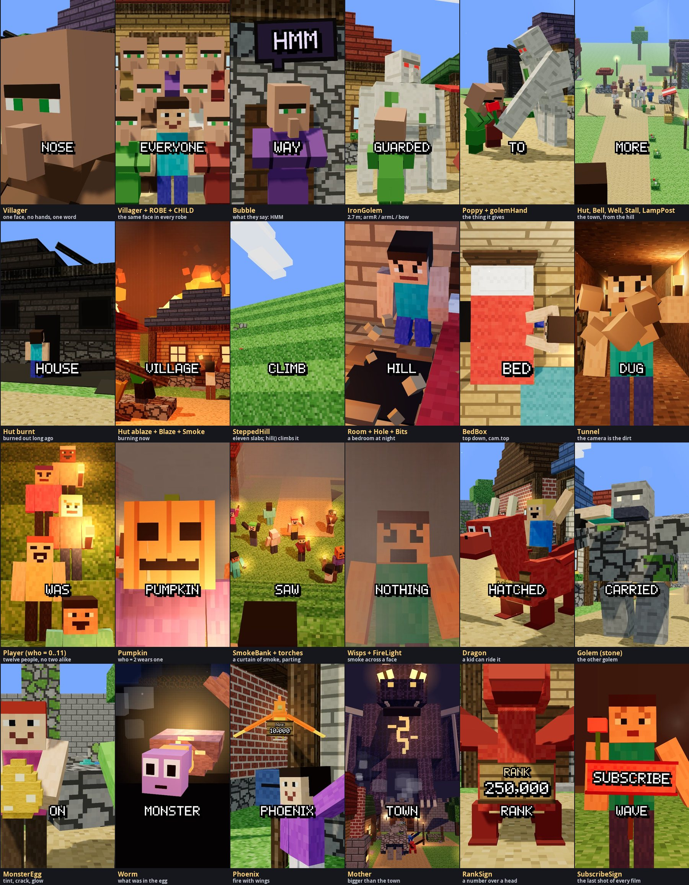

# The pack: what an "In This Town" film is built from

The people, places, things and staging maths of the finished films, kept in this folder so the next film starts from
them and not from nothing. The owner approved these as they look ("i like the assets"). **Use them. Do not rebuild
them, and do not restyle them.**



Every still above is a shot from one of the two finished films: the reference film, `in-this-town-same-face` (the first sixteen and the
last) and `in-this-town-monster-egg`.

## How a film uses it

```
Topics/InThisTown/index.ts      everything below, from one import
        ↓
src/videos/<film>/kit.tsx       passes on what the film uses, and adds the film's own: the teller, PLACE, timing
        ↓
src/videos/<film>/sceneN.tsx    imports only from "./kit"
src/videos/<film>/world.tsx     lays the town out with the pack's places
```

`npm run new -- "In This Town, …" --topic in-this-town` gives you a `kit.tsx` and a `world.tsx` that are already
wired this way. The reference for both is `src/videos/in-this-town-same-face/`.

**Before you build anything, look for it here.** If it is not here and a second film could use it, build it here
(the rules are at the bottom). Only what belongs to one story stays in that film's `kit.tsx`.

## Staging — `staging.ts`

| Name | What it gives you |
|---|---|
| `wordClock(timing)` | Makes `wordAt(cue, word, nth?)`: seconds into a shot at which a word is said. **Hang every action on a word** |
| `pop(t, at, dur?)` | The scale of a thing that pops into being at `at`: 0, a small overshoot, then 1 |
| `ramp(t, a, b)` | 0 before `a`, 1 after `b`, straight between. `ease(k)` smooths it |
| `jolt(t, at, size?)` | A short shake that dies away: a hit, a landing |
| `ahead(p, rotY, dist, up?)` | The point `dist` metres in front of someone |
| `beside(p, rotY, side, up?, front?)` | A point in someone's own axes: to their right, up, in front |
| `SOUTH` `EAST` `NORTH` `WEST` | Facings, as `rotationY`. The street runs west–east; the camera usually stands south |
| `DEG` | `Math.PI / 180` |
| `KID` | 0.8: the scale of a child player |
| `faceOf(p, scale?)`, `chestOf(p, scale?)` | Where a player's face and chest are, for the camera's `on` |
| `hill({ x, layers, width, step })` | The maths of a stepped hill: `stepAt(i)`, `stepEast(i)`, `climb(from, steps, p)`, `top` |

## The town's people — `villagers.tsx`

| Name | What it is | Props that matter |
|---|---|---|
| `Villager` | The villager. One face, one eyebrow, one long nose, arms folded into one block. **There is exactly one face: do not add another** | `robe`, `scale` (`ADULT` 0.94, `CHILD` 0.7), `kid`, `walk` (metres), `lookAt` (a world point), `nod` `turn` `tilt`, `hmm` 0–1, `strain` 0–1 (trying to get the arms out), `lean` (a bow), `hat="straw"`, `phase` |
| `ROBE` | Eight robe colours: `brown elder friend white smith farmer red blue`. The robe is the only way to tell two villagers apart, so give each named one their own | |
| `villagerFace(p, scale?)`, `villagerChest(p, scale?)` | Where a villager's face and chest are, for the camera | |
| `IronGolem` | The iron golem, 2.7 m tall | `walk`, `armR` / `armL` (radians: 0 hangs, −1.5 points ahead; leave out and they swing), `headPitch`, `headYaw`, `bow`, `flower` |
| `golemHand(p, rotY, angle, scale?, side?)` | Where its hand is in the world, for an arm at `angle`. Put the thing it gives there | |
| `Poppy` | A poppy. `position` is the bottom of the stem | `rotation`, `scale` |

## People who are not from the town — `players.tsx`

| Name | What it is | Props that matter |
|---|---|---|
| `Player` | One of twelve players, no two alike in skin, hair and clothes. Takes every `MinecraftAvatar` prop | `who` 0–11, `torch`, `light` (makes the torch a real light), `animation`, `face` |
| `PLAYERS` | The twelve looks. `who = 0` has a beard, `who = 2` wears a pumpkin | |
| `Pumpkin` | A carved pumpkin, worn as a head | `position` (its middle), `rotationY`, `scale` |

The **teller** is not in the pack. Each film has its own, in its `kit.tsx`: a kid in one loud colour nobody else in
that film wears.

## Things — `things.tsx`

| Name | What it is | Props that matter |
|---|---|---|
| `Bubble` | A speech bubble. It faces +Z: give it the camera's yaw | `text`, `position`, `rotationY`, `scale` (use `pop`), `dark`, `tilt`, `tail` −1 / 1 |
| `BedBox` | A Minecraft bed, red blanket. The pillow is at −Z | `position` (its middle, on the floor), `rotationY` |
| `Hole` | A hole in a floor: black, with a broken edge | `position`, `size`, `rim` |
| `Bits` | Bits of a block that has just been broken | `position`, `t` (seconds since the hit), `color`, `count`, `power`, `toward` |
| `Smoke` | A column of smoke that rises, swells and thins | `position`, `rise`, `spread`, `size`, `count`, `lean`, `opacity` |
| `SmokeBank` | A wall of smoke across a valley, seen from the west | `x`, `amount` (1 hides everything, 0 is clear), `part` (opens it like a curtain), `t` |
| `Wisps` | Smoke drifting across a face | `position`, `t`, `dir`, `reach`, `count`, `opacity` |
| `Blaze` | A roof on fire: cubes of flame that rise and redden | `position` (the bottom of it), `size`, `height`, `count` |
| `FireLight` | Warm, flickering light from a fire that is out of frame | `position`, `power`, `reach` |

## Places — `places.tsx`

These are **parts**. Where they stand is the film's business: each film lays out its own town in its `world.tsx`.

| Name | What it is | Props that matter |
|---|---|---|
| `Hut` | A village house. `at` is the middle of its front wall, on the ground. `turn` 0 faces south | `w` `d` `h`, `wall` (a block kind), `tint`, `roof`, `door` (x offset), `windows` (x offsets), `burnt` (black, half a roof, long ago), `ablaze` (the windows glow; add `Blaze` and `Smoke`) |
| `Bell` | The village bell on its stone step | `position`, `fallen` |
| `Well` | The village well | `position` |
| `Stall` | A market stall. Its counter top is y = 1.0 | `position` |
| `LampPost` | A torch on a post | `position`, `seed` |
| `SteppedHill` | The slabs of a stepped hill. Give it the same numbers as `hill()` | `x`, `layers`, `width`, `length`, `step`, `taper`, `tints` |
| `Room` | A bedroom, 5.4 m wide and 8 m deep, one window. **No south wall: the camera lives there.** It has no bed; the scene puts one in | `at`, `night` |
| `Tunnel` | A tunnel through dirt, 16 m long, one block wide, two torches. Open at +x: the camera stands where the dirt still is | `at` |

## Creatures — `creatures.tsx`

Built for the monster-egg film. Any film may use them.

| Name | What it is | Props that matter |
|---|---|---|
| `MonsterEgg` | An egg the size of a kid's chest | `color`, `spots`, `cracked`, `glow` 0–1, `open` 0–1, `tilt`, `halo` |
| `Worm` | What was in the egg | `crawl` (metres), `lift`, `mouth`, `rank` |
| `Dragon` | A dragon a kid can ride | `color`, `belly`, `bow`, `headYaw`, `mouth`, `fly`, `rear`, `fold` (wings back, for a narrow frame), `rank`, `gold` |
| `Phoenix` | Fire with wings | `fly`, `bow`, `letter`, `rank` |
| `Golem` | A stone golem that carries things. Not the iron one | `walk`, `carry` 0–1, `bow`, `eyes`, `rank`, `children` (what lies in its arms) |
| `Mother` | Bigger than the town | `spread`, `lower`, `fire` |
| `Chicken` | A chicken | `phase` |
| `Fire` | A stream of fire from one point to another | `from`, `to`, `power`, `tail`, `funnel` |
| `Puffs` | Smoke, steam or dust as cubes | `position`, `color`, `count`, `rise`, `spread`, `size` |
| `SoundRings` | A roar you can see | `position`, `t`, `color`, `reach` |
| `RankSign` | A wooden board with a number | `rank`, `gold`, `post` |
| `SubscribeSign` | The red sign the last shot of **every** film holds | `position`, `rotationY`, `scale`, `tilt` |

## What is not in the pack

- **The story.** Never reuse a premise, a line or a twist from a finished film.
- **The teller.** A new kid for every film.
- **The layout of the town.** `template/world.tsx` is a starter to change.
- **The third place**: what the rule was hiding (the other side of the hill, the bottom of the lake). That is new in
  every film, and it is where the film's own building work goes.

## Adding to the pack, or changing it

1. A pack part takes a `position` (or `at`) and knows nothing about any film's town. No film's coordinates in it.
2. Same look as the rest: boxes, flat colours, the engine's block kinds. Feet on `position`, facing +Z, 1 unit = 1 m.
3. Export it from its file; `index.ts` already passes every file on. Add a row to this page.
4. **A change here changes every film that uses it, and the finished films are approved exactly as they are.** Before
   you touch a part that exists, take the stills of both; after, take them again; they must not differ by a pixel:

   ```bash
   node scripts/shots.mjs in-this-town-same-face --scale 0.4 --at 0.55 --out out/before/same-face
   node scripts/shots.mjs in-this-town-monster-egg --scale 0.4 --at 0.55 --out out/before/egg
   #   …the change…
   node scripts/shots.mjs in-this-town-same-face --scale 0.4 --at 0.55 --out out/after/same-face
   node scripts/shots.mjs in-this-town-monster-egg --scale 0.4 --at 0.55 --out out/after/egg
   python3 scripts/compare-stills.py out/before/same-face out/after/same-face
   python3 scripts/compare-stills.py out/before/egg out/after/egg
   ```

   If your film needs a part to look different, give the part a new prop whose default is the old look.
