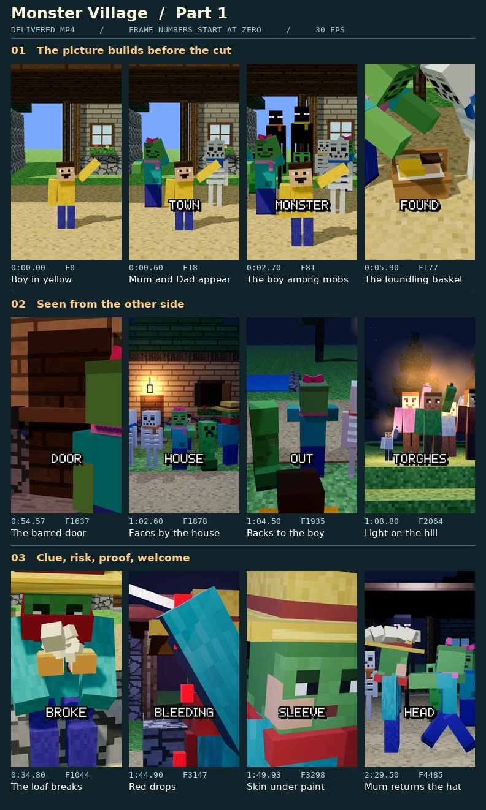

# Monster Village, Part 1 — a director’s readme for the next Short

**Borrow the change of mind, not the monster family.** At 0:54 the bar across the boy’s door looks like a way to keep him in. At 1:04 we see the backs of the people outside. They are looking *away* from him. The bar hasn’t changed; our idea of the people who put it there has. That’s a more useful thing to build a new scene around than “cut every two seconds.”

**Start here:** open the [delivered Short](in-this-town-monster-village.mp4). Play **0:00–0:07** muted, **0:53–1:10** from the boy’s point of view, then **2:23–2:33** to see what Mum does with the hat. Before pitching, fill in the [transfer card](#the-transfer-card) for *your* idea. [Same Face](../same-face/README.md) remains the topic’s production reference; this is a study of one film, not a replacement for the [owner’s brief](../../../../MASTERPROMPT-01.md).

**Which cut?** This MP4 is 1080×1920, 30 fps, 5,251 frames (2:55.03); the [cut and word clock](source/timing.json) has 74 cues and 713 words. The older 3:41 cut in some audits and the sequels are not the clock below. The visual study used phone-size frames decoded from every cue, plus frames inside the key actions. The strip below is a selection from the MP4, not a reconstruction from the scene notes. The readings below are interpretations, not a graph of what viewers felt.

## Why a stranger might stop: watch one shot change

- **0:00–0:02.73 · `1.town`.** Frame 0: a small boy in yellow, arm up, sunny path, empty space behind him. At 0:00.40 the green figure with the pink bow is there; by 0:00.60 there’s a skeleton on the other side. By the word **“only”** (1.148 s) he has company; by **“monster”** (2.108 s) the crowd fills the space around his head. He stays easy to find. It’s **one shot**, not eleven cuts; you needn’t be able to count every partly hidden mob to get the joke. The picture says “he fits here”; the voice says “I’m different.” Which should we believe?
- **0:02.73–0:06.80 · `1.mum` → `1.dad` → `1.me`.** Nearer views give two faces from that crowd names a child would use: *Mum. Dad.* Then the camera looks **down** between them at the basket. “A boy they found in a basket” tells us how he joined this family without telling us who brought him. Now being different costs somebody something. A line of village history would not do that job.
- **0:06.80–0:18.37 · `2.hiss` → `3.me`.** The creeper wants a hug; nobody wants to receive it. The school bus is a slime; the boy comes out wet. Bright green, flying cubes, a yellow body going in and out: these are little stories with endings, not a tour of assets. The sun rule then leaves the boy playing alone. Hiss will matter again; the bus gag already earned its time. Not every prop needs a secret.

## Why there is still a story after the hook

Times are on the delivered cut. The questions are ones the film makes *possible*, not recorded audience responses. Use the [shot log](shot-log.md) to find a cue and the [spoken script](source/narration.md) to check what the boy actually knows.

| Time / cue | What the viewer sees or hears | The question that changes |
|---|---|---|
| **0:18–0:50** · `4.stare`, `5.bread`, `6.lamp` | Mo’s scarf hides his mouth. The boy reads his long stare as dislike. But Mo **sits beside** him in the sun, blames the hat, breaks bread for a hungry kid, needs a lantern and sneezes. The boy has a good reason to take the food instead of interrogating the giver. | Not just “Is Mo human?” A viewer can guess early and still want to know **why he hides, and why he’s kind to this boy**. The bread is lunch before it is evidence; the sneeze is something they have in common before it is a clue. |
| **0:50–1:10** · `7.lock`, `8.window`, `9.out` | The outside bar makes the boy think he’s weak. He climbs out. First we see faces by the house; the reverse puts us behind their backs. **“Out”** lands at 1:04.35; the next light on the hill belongs to strangers. | “Why do they lock him in?” gets a real answer **now**: they’re guarding him. That immediately earns a new question: *from whom?* No extra speech explaining that Mum loves him. |
| **1:10–1:40** · `12.mum`, `13.front`, `14.trick` | The “monsters” are home; the players are the danger. Mum falls. The boy looks like a player, so he runs in front of her with arms out: “I live here!” The big player calls **him** a monster in disguise. The boy shuts his eyes. | His choice follows from the *first line*. It costs him something and **doesn’t work**. Now someone else has to choose whether to be seen. The accusation also sets up the disguise that’s real. |
| **1:40–2:11** · `15.red`, `16.paint`, `17.basket`, `18.hunt` | Mo intervenes. Red drops show against his blue sleeve. He lowers the scarf; the wipe leaves a **patch** of skin, not a whole new face. Only then does he say “I am human too” (“human” at 1:55.18). Bread, lantern, sneeze and sun are named back. We see the basket again, this time **in Mo’s arms**. The player recognizes him. | The reveal answers more than “what species?” His stare was recognition; the boy wasn’t alone; the raiders came for **Mo**. The later picture explains a specific earlier one. Take the basket out of the opening and the later line loses its force. |
| **2:11–2:33** · `19.hiss`, `20.mo`, `20.mum`, `20.knew` | The players look at Mo. Hiss gets close: **“Hug”** at 2:16.65. Cut to empty-handed players fleeing, swords left on the path. Then Mo holds his hat low; **Mum puts it back on his head**. “We always knew. Zombies do not eat bread.” | Two different rewards. Hiss’s old joke now changes the action. The loaf that fed the boy was also evidence the family noticed. **Acceptance is the gesture**, not a speech about tolerance. |
| **2:33–2:55** · `21.army`, `22.alone`, `22.armor`, `22.sub` | Only *after* welcome comes the bigger army. Wide: Mo alone between the village and the crowd. Close: hat off, iron on, sword up. The subscribe sign and line arrive at **2:53.17**. | “Do I belong?” has been paid. **What will Mo do now?** can belong to Part 2. If your story ends in one part, keep the earned ending; don’t manufacture an army or hold the promised answer hostage for a follow. |

## Put the word, the action and the sound on the same event

Scrub **0:34.20 → 0:34.80 → 0:35.23**. One tan loaf, hands apart with crumbs, two halves. The [word clock](source/timing.json) puts “broke” at 34.758; frame 1044 reads **BROKE**. The [sound sheet](source/sound.json) calls for a crack on that word. A generic talking close-up with a loaf floating beside it would satisfy the noun and lose the verb. The lamp against the dark and the pale cheek against green work for the same reason: the important change survives a small screen. The caption helps you name it; it shouldn’t be the only place it happens.

The [mix lock](source/sound.lock.json) records 254 effects, 23 music **sections**, music 17.7 dB under voice, −14.8 LUFS and −2 dBTP. The music is marked `none` from **1:32.57–1:39.20**, as the boy’s defence fails. Not dead silence: speech and effects remain. The archived mix hash matches, and five one-second audio samples from the delivered MP4 line up with that mix. No listening pass was available for this study. These are measurements, **not** an effects quota. The opening [stage](source/scene1.tsx) staggers entrances; the sheet even has a legacy `offset` that the [builder ignores](../../SOUND.md). Don’t promise ten perfectly synchronized pops from reading the notes. On a new cut, listen to the exported mix at speed: can you hear the word that changes the picture? Don’t credit this old upload’s results to a new caption or shader preset.

## Two comparisons worth making

1. **A real, limited performance comparison.** The [owner’s Nov 14 notes](../../OWNER.md) place the two Superpower films around 1.3k views each and 63–65% stayed to watch *then*. In the approved [Superpower Part 1](../superpower-at-18/README.md), the opening frames show a villager under a bell; the cut goes closer and then to the bell. By 0:05.50 we know how powers are granted. The twin relationship is named at 0:13.97. By contrast, Monster Village spends its first 0:06.80 introducing a family and leaving a basket unexplained. **Test “person affected before rule explained,” not “more cuts.”** This is a difference you can point to, not proof it caused the gap or that either film is the owner’s current 2k upload.
2. **A creative comparison, not a leaderboard.** The [cat/creeper film](../everyone-runs-away-from-me/README.md) already has a cat amid creepers at frame 0; the [enderman film](../never-seen-my-mums-face/README.md#too-close-to-the-creeper-film) already pairs the child with a towering parent. Both are legible. The owner liked them **and** spotted the repeat: adopted outsider wants closeness → repeated failed attempts → six raiders after a mob drop → the kid’s difference saves everyone → quiet moment with Mum. Swapping hug for eye contact didn’t change the story. No per-upload analytics were supplied for that pair. **Cover the mob names: if the two pitches still tell the same chain of events, rewrite the cause, choice or ending before recording.**

## The transfer card

Use your existing `narration.md` (pitch), `STORYBOARD.md` (cue and word) and `REVIEW.md` (result). **“Studied Monster Village” isn’t a review.** Fill these three rows with things another person could check. Keep the owner’s idea, script and voice approval stops; this is not a new render step.

| Borrow one job | Before recording: reference time → your different beat | In review: point to the evidence or mark unchecked |
|---|---|---|
| Opening | What can I point at in the first vertical frame? What changes **within** the first phrase? Give three hook options; choose one for the question it raises about a person. | Your cue + frame 0, an inside-action frame and the end of the phrase. Mute it; cover the caption. Describe the change without using the title. If the answer is only “camera zooms,” restage it. |
| Change of mind | “At ___ the teller thinks ___. The viewer can already see ___. Later ___ makes that same detail mean ___.” Name the object/action and the word it lands on. | Your before + after cues, and the intervening action. Is the evidence visible **before** the explanation, or only mentioned in the script? Fix a hidden mark, crop or missing reaction and recheck the same frames. |
| Choice and reward | Who chooses, what might they lose, and what is settled *before* the CTA? Why couldn’t the last line belong to either of the last two uploads? | Your payoff and CTA times. Watch the ending at phone size, then listen without following the script. Record what read, what didn’t and what you changed. A passed [rehearsal](../../../../docs/DIRECTING.md) or a silent sheet is not a listening pass. |

**Worked transfer, not a pitch to reuse:** Borrow `9.out`’s reverse, not its ring of guards. A sign painter watches the market arrow swing toward his stall; he blames the apprentice who keeps touching it. Early clue: a streak of fresh yellow on a passing cart hub. In the new reverse we finally see the hub **clip** the low arrow and the apprentice straighten it. Show wheel, blade and hand in that order on “clip”; if the axle is below the phone crop, the shot fails. Now the painter raises the arrow, even though the queue goes to the other stall. The payoff is the next cart passing without turning it. Different job, mistake, cost and comic ending; no hidden ancestry, raid or sequel. For your own pitch, apply the owner’s [originality check](../../OWNER.md): compare teller, place, problem, player’s role, ending and feeling with each of the last two films. More than two matches with either? Repitch.

## After upload: find out which problem you actually have

**Owner’s Nov 18 report:** Part 1 ≈18k views, 100+ likes, **83% stayed to watch**; one other Short ≈2k, most ≈1.4–1.5k. That 83% is the *stayed versus swiped* measure, **not** 83% completion, average percentage viewed, or the fraction still there at a known second. The [earlier export](../../../../MASTERPROMPT-01.md) at 7,047 views, 178.33 watch hours and +21 subscribers is a different snapshot. Don’t divide across snapshots. We have no current second-by-second audience curve, like timestamps or matched exposure data. The numbers identify a standout, not the shot that got it recommended.

For the next release, write down **one prediction before upload** (e.g. “showing who loses out before explaining the rule will help the opening”). Compare Part 1, one *named* ordinary Short and the new one over the **same age since publication** and traffic source, especially Shorts feed. Keep the Studio labels and counts: shown in feed, stayed/swiped, engaged views, average view duration and percentage viewed, retention graph, likes. Record the title, runtime and dates for each. Then:

- **Lower stayed rate?** Compare the first phrase muted and voiced. What did a stranger have to wait for? Change that first, not the finale.
- **Similar stayed rate, earlier drop later?** Mark the first sustained dip on the graph and the cue *just before* it. Was a clue invisible, a choice delayed, or a question repeated instead of answered? Check the actual cut before changing speed. Compare equivalent story beats as well as seconds on different-length films.
- **Similar rates, different views?** Check feed exposure and audience mix before blaming the script. A spike can mean a replay **or** confusion. If graphs aren’t available, write “unknown” and keep the visual test; don’t invent a drop or promise 18k again.
