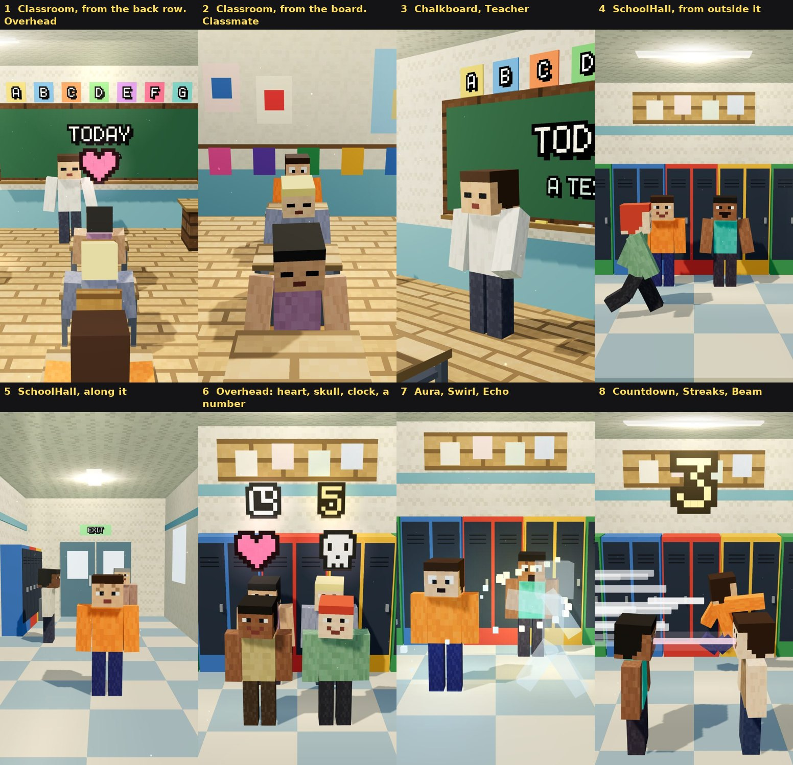

# The What If pack

Everything a film of this topic is built from. One import:

```ts
import { Classroom, Overhead, Echo, Classmate } from "../../../Topics/WhatIf";
```

A film's `kit.tsx` imports from the pack and passes the names on, so its scenes import only from `"./kit"`.



> **Not yet approved in a film.** Every part here has been rendered and looked at (the picture above), but none
> has been seen by the owner in a film. The first approved "What if" film decides what stays. The parts passed on
> from In This Town are the exception: those come from approved films.

1 unit = 1 metre. A kid is 1.44 m tall (`scale={KID}`), a grown-up 1.8 m. People stand with their feet on
`position` and face +Z (south) at `rotationY` 0; `NORTH`, `EAST`, `SOUTH`, `WEST` are the four facings.
Everything is deterministic: a part that moves is given seconds (`t`), never a clock of its own.

## The school — `school.tsx` (pictures 1–5)

| Part | Props | Use it for |
|---|---|---|
| `Classroom` | `at` (the middle of its floor), `board`, `boardSub` (words on the board), `night`, `doorOpen` 0–1, `books` | Where a kid with a power is seen by everybody he knows. Nine desks, a board, windows on the west wall, a door on the east. 9.4 × 8 m, 3.6 high |
| `classroom(at)` | → `seat(col, row)`, `face(col, row)`, `desk(col, row)`, `teacher`, `board`, `door`, `aisle`, `at(x, y, z)` | The places in a classroom. Column 0 is by the windows; row 0 is the front. Never type a desk's numbers twice |
| `SchoolHall` | `at` (the middle of its floor), `length`, `sign` | A hallway of lockers, with two classroom doors and EXIT doors at both ends. It runs west to east; 4 m deep |
| `Desk` | `position`, `book` (a colour, or none) | One desk and its chair, for a kid |
| `Chalkboard` | `position` (its middle), `text`, `sub`, `width` | A board with one or two words on it, anywhere |

The south wall of `Classroom` and of `SchoolHall` is **one-sided**: a lens inside sees a wall, a lens behind it
sees straight through. [`SHOTS.md`](SHOTS.md) §2 says how to use it.

## How a power is shown — `powers.tsx` (pictures 1, 6–8)

Give a power ONE of these in its first shot and never change it ([`SHOTS.md`](SHOTS.md) §1). Every part takes
seconds (`t`) and is still when `t` is still: pass the shot's `t`, or `t - wordAt(cue, word)`.

| Part | Props | Use it for |
|---|---|---|
| `Overhead` | `over` (the person's FEET), `kind` (an icon) or `text`, `t`, `tall`, `size`, `color`, `rotationY`, `spin`, `fade` 0–1 | What only the teller can see about somebody: a heart, a skull, a clock, a number. Pops in as `t` passes 0. `tall` is the person's height (1.44 a kid, 1.34 a seated kid, 1.8 a grown-up) |
| `Aura` | `position` (the feet), `t`, `power` 0–1, `color`, `tall` | The power is ON. A ring of bright cubes round a body |
| `Swirl` | `position` (the feet), `t` (seconds since it began), `seconds`, `color` | The power arriving, once. A spiral that climbs and is gone |
| `Echo` | `position`, `rotationY`, `walk` (metres), `reach` 0–1, `lean`, `color`, `opacity` | A see-through copy of a person in one colour: five seconds from now, a memory, somebody who is not there |
| `Streaks` | `position` (the middle of the mover), `heading`, `t`, `speed` 0–1, `color` | Speed. Lines trailing behind something fast. Stage it against something dark |
| `Countdown` | `position`, `t`, `from`, `every`, `height`, `rotationY` | A number in the air counting down to 0. The last number turns red |
| `Beam` | `from`, `to`, `grow` 0–1, `color`, `width` | A line of light between two people, or from him to a thing |

## The people round him — `cast.tsx` (pictures 2–6)

| Part | Props | Use it for |
|---|---|---|
| `Classmate` | `who` (0–11), and every avatar prop: `position`, `rotationY`, `animation`, `face`, `headPitch`, `lookAt`… | One of the class. Twelve looks, no two alike, none in a colour loud enough to be taken for a lead |
| `KIDS` | | The twelve looks, if a film needs to dress somebody like one of them |
| `Teacher` | every avatar prop | A grown-up, a head taller than the class |

**Not in the pack: the teller, the best friend, the one the story is about.** Every film dresses its own in its
`kit.tsx` (the starter has `Hero` and `Friend`): the teller in one loud colour that nobody else wears.

Faces for a kid: `smile grin laugh frown uneasy brave fear wow ouch calm`. Change the face on the cut.

## Shared with the other topics — [`Topics/Shared`](../Shared/README.md)

| Part | Use it for |
|---|---|
| `Icon` (`kind`, `height`, `color`, `outline`) | One small picture in cubes: heart star bolt bang question check cross up down eye clock skull coin gem drop crown |
| `Figure` (`text`, `height`, `color`, `outline`) | A number or a short word in cubes |
| `Voxels` (`rows`) | Any picture you draw yourself, in rows of `#`: the look of a power the pack does not have |
| `wordClock(timing)` → `wordAt(cue, word)` | Seconds into its shot at which a word is said |
| `pop`, `ramp`, `ease`, `jolt`, `ahead`, `beside`, `faceOf`, `chestOf` | Staging, from In This Town |
| `Room`, `BedBox` | The teller's room at home |
| `Hut`, `LampPost`, `Player` | A street outside, and twelve more people |
| `Bubble`, `Bits`, `Puffs`, `SoundRings` | A speech bubble; bits that fly when something breaks; dust; rings of sound |
| `SubscribeSign` | The red sign every film of the channel ends on |

[The In This Town pack](../InThisTown/PACK.md) describes each of the parts that came from it.

## Adding a part

1. Build it in the film first, in its `kit.tsx`. A part goes into the pack when a second film could use it.
2. Put it in the file it belongs to, with a comment that says what `position` is and what it is FOR.
3. It takes a `position` (or `at`), so it does not know where any film's school is. If it moves, it takes seconds.
4. Add its row to the table above, and add it to the sheet (below).
5. If you change a part that a finished film uses, prove the film did not change:
   `python3 scripts/compare-stills.py out/before/<film> out/after/<film>`.

## Rebuilding the sheet

`pack.jpg` is eight stills of a film that exists only to show the parts. Its source is in [`sheet/`](sheet/):
one shot for each picture (`scene1.tsx`), and the name over each (`labels.txt`). To add a part, put it in a shot
there, or add a shot and a line of `narration.md` and of `labels.txt`. Then:

```bash
npm run new -- "Pack Sheet" --topic what-if
cp Topics/WhatIf/sheet/*.tsx Topics/WhatIf/sheet/narration.md src/videos/pack-sheet/
#   delete the `captions:` line from src/videos/pack-sheet/film.tsx, so the stills have no words on them
python3 scripts/narration.py build pack-sheet --estimate
npm run shots -- pack-sheet --at 0.6 --out out/pack-what-if
python3 scripts/pack-sheet.py out/pack-what-if Topics/WhatIf/pack.jpg --labels Topics/WhatIf/sheet/labels.txt
#   then delete src/videos/pack-sheet/ and take its two lines out of src/registry.ts
```

`sheet/` is left out of the type check, like `template/`: its imports only resolve inside `src/videos/`.
